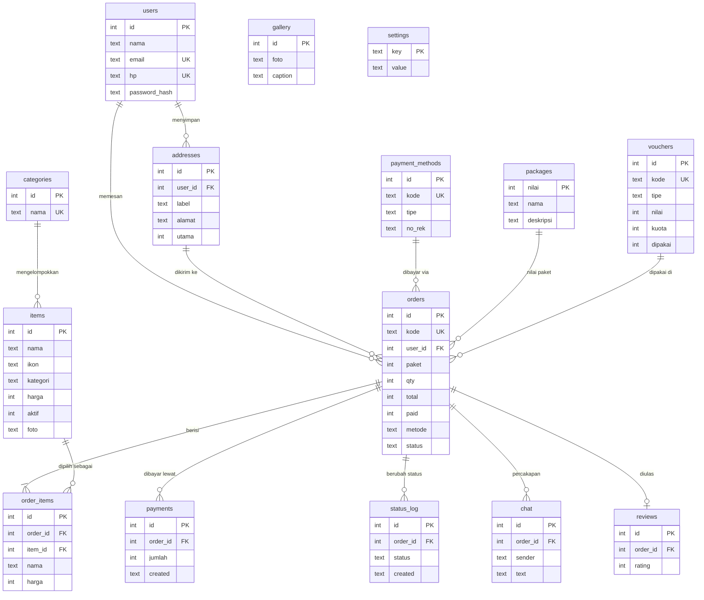

# Database Parcelku

Aplikasi mendukung dua mesin database, dipilih lewat `DB_ENGINE` di berkas `.env`:

| Mesin | Kapan dipakai | Berkas struktur |
|-------|---------------|-----------------|
| **MySQL / MariaDB (XAMPP)** | Disarankan untuk toko yang sudah memakai XAMPP | `schema_mysql.sql`, `parcelku_xampp.sql` |
| SQLite | Satu berkas `parcelku.db`, tanpa server | `schema.sql` |

Aplikasi membuat database dan tabel sendiri saat pertama dijalankan, jadi database lama ikut ditingkatkan tanpa
kehilangan data.

## Memakai XAMPP (MySQL)

1. Buka **XAMPP Control Panel**, tekan **Start** pada **MySQL** (Apache tidak wajib).
2. Salin `.env.example` menjadi `.env`. Isinya sudah cocok dengan XAMPP: `DB_ENGINE=mysql`, user `root`, password kosong,
   database `parcelku`.
3. Pasang paket: `pip install -r requirements.txt`, lalu jalankan `python app.py`. Database `parcelku` dibuat otomatis.
4. *(Opsional)* Lihat atau kelola data di `http://localhost/phpmyadmin`. Untuk membuat database manual, impor
   `database/parcelku_xampp.sql` lewat tab **Import**.
5. *(Bila punya data lama di `parcelku.db`)* pindahkan dengan: `python database/sqlite_ke_mysql.py`.

Bila password MySQL diganti, isi `MYSQL_PASSWORD` di `.env`.

## Cara pakai

```bash
python database/init_db.py                 # buat database baru + data awal
python database/init_db.py --demo          # plus 3 pelanggan, 3 pesanan, ulasan, chat contoh
python database/init_db.py --reset --demo  # hapus lalu buat ulang (HATI-HATI: data hilang)
```

Berkas di folder ini: `schema.sql` (struktur), `seed.sql` (data awal), `init_db.py` (pembuat database).

## Diagram relasi (ERD)



## Tabel

| Tabel | Fungsi |
|-------|--------|
| `users` | Akun pelanggan: nama, **email**, nomor telepon, kata sandi (disimpan sebagai hash) |
| `addresses` | **Banyak alamat per pelanggan** (label, penerima, titik lokasi, alamat utama) |
| `payment_methods` | **Metode pembayaran**: QRIS, transfer bank, e-wallet, tunai (dikelola admin) |
| `packages` | Pilihan nilai parcel: Hemat, Favorit, Premium |
| `categories`, `items` | Katalog barang yang bisa dipilih pelanggan |
| `vouchers` | Kode promo: persen, nominal, atau gratis ongkir |
| `orders` | Pesanan: harga, pembayaran, pengambilan, wadah, pita, **kartu ucapan custom** (untuk, pesan, dari, gaya, warna) |
| `order_items` | Rincian isi tiap pesanan (nama dan harga disalin saat pesan, tidak berubah walau katalog diubah) |
| `payments` | Riwayat setiap pembayaran yang dicatat admin |
| `status_log` | Riwayat perubahan status (dipakai linimasa di struk) |
| `chat`, `reviews` | Percakapan dan ulasan per pesanan |
| `gallery`, `settings` | Foto galeri dan pengaturan toko |

## Otomatisasi (trigger)

- Kode pesanan `PK0001`, `PK0002`, ... terisi otomatis.
- Status awal dan setiap perubahan status tercatat di `status_log`.
- Setiap kenaikan `orders.paid` tercatat di `payments`.

## View laporan (siap di-query)

```sql
SELECT * FROM v_pesanan_aktif;      -- pesanan belum selesai, urut tanggal acara
SELECT * FROM v_penjualan_harian;   -- omzet & uang masuk per hari
SELECT * FROM v_barang_populer;     -- barang yang paling sering dipilih
SELECT * FROM v_rating;             -- jumlah dan rata-rata ulasan
SELECT * FROM v_orders;             -- ringkasan pesanan + status bayar (Lunas/DP/COD/Belum bayar)
```

## Cadangan

Salin `parcelku.db` dan folder `uploads/` secara berkala. Untuk cadangan aman saat aplikasi berjalan:
`sqlite3 parcelku.db ".backup cadangan.db"`.
